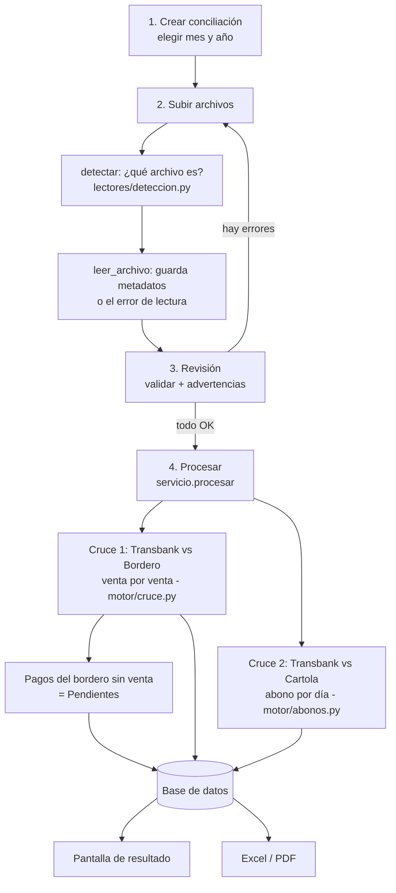

# Guía del código: cómo funciona la conciliación

Documento para entender y modificar el proyecto. Explica qué hace cada parte, en qué orden y dónde tocar para cambiar algo.

---

## 1. Mapa rápido: qué carpeta importa

| Carpeta / archivo | ¿Se usa? | Qué es |
|---|---|---|
| `conciliacion/` | **Sí, es el sistema** | Toda la conciliación en pesos (CLP): lectura de Excel, cruce, reportes, pantallas. |
| `hotel/` (`settings.py`, `urls.py`) | Sí | Configuración de Django (base de datos, rutas, Vercel). |
| `hotel/conciliacion/` | **No** | Archivos vacíos de un intento anterior. Se pueden borrar. |
| `web/` | Solo la ruta `/dolares/` | Proyecto viejo (conciliación en dólares + modelos de un sitio de reservas). No participa en la conciliación CLP. |
| `GuiaTareas.md`, `IdeasFuturas.txt` | No | Planificación antigua; ya no refleja el código. |

Dentro de `conciliacion/` el código está separado en 4 capas:

```
conciliacion/
├── lectores/     1) LEER: abre cada Excel y lo convierte en una tabla limpia
├── motor/        2) CRUZAR: compara las tablas y clasifica cada venta
├── servicio.py   3) ORQUESTAR: junta lectores + motor y guarda en la base
├── reportes/     4) REPORTAR: arma Excel y PDF desde lo guardado
├── views.py      Pantallas (subir archivos, revisar, ver resultado)
└── models.py     Tablas de la base de datos
```

---

## 2. El flujo completo (lo que pasa cuando el usuario usa el sistema)



Rutas (en `conciliacion/urls.py`): `nueva/` → `archivos/` → `revision/` → `procesar/` → `detalle/` (resultado) → `excel/` y `pdf/`.

---

## 3. Los 5 archivos y cómo se reconocen

El sistema **no mira el nombre del archivo**, mira su contenido (`lectores/deteccion.py`):

| Archivo | Cómo lo reconoce | Lector | Qué saca |
|---|---|---|---|
| Transbank (débito / crédito / prepago) | Tiene "Abonos por día" y "Medio de pago:" | `lectores/transbank.py` | Una fila por venta: fecha, **código de autorización**, monto, comisión, cuota (`1/3`), etc. + el resumen del archivo (Total abono). |
| Bordero (hotel, FrontOffice) | Tiene "Cargos de Débitos y Créditos" | `lectores/bordero.py` | Una fila por pago: Cod. Deb. (tipo de tarjeta), **Documento** (el código que digitó el recepcionista), valor, fecha, hora. |
| Cartola Banco de Chile | Tiene "Movimientos" y "Cuenta N" | `lectores/cartola.py` | Movimientos: fecha, descripción, cargo, abono, saldo. |
| Cartola BancoEstado | Tiene "Cartola Histórica" y "N° Cuenta Corriente" | `lectores/cartola.py` (`_bancoestado`) | Lo mismo, desde la hoja "Movimientos". |

Funciones de apoyo en `lectores/comunes.py`:
- `clave()` → pasa texto a minúsculas sin acentos (para comparar encabezados sin que importe cómo vienen escritos).
- `normalizar_codigo()` → quita espacios, pasa a mayúsculas y **quita ceros a la izquierda** (`"00123"` = `"123"`).
- `a_entero()` → convierte `"16.258.428,00"` a `16258428`.

### Validaciones antes de procesar (`servicio.validar`)
Bloquean la conciliación si:
- Falta el bordero, la cartola o al menos un Transbank.
- Un Transbank tiene fecha de abono de otro mes.
- Un Transbank abarca varios días de abono (se exige un archivo por día).
- El resumen del Transbank no cuadra consigo mismo (ventas − comisiones ≠ total abono).
- Hay dos Transbank del mismo medio y mismo día (repetido).
- Moneda distinta a pesos (a menos que se active "omitir" en Parámetros).

Además, al subir, se calcula el **SHA-256** del archivo para no aceptar el mismo archivo dos veces.

---

## 4. La lógica del cruce (el corazón del sistema)

### 4.1 La llave de cruce

Transbank y el bordero no comparten un ID común "oficial". La llave que se usa es:

> **Código de autorización (Transbank)** ⇄ **Documento (bordero)**

El recepcionista copia el código del voucher en el campo Documento. Si lo copia mal, ahí nace el "error de digitación".

¿Qué filas del bordero son tarjetas? Las que tienen un **Cod. Deb.** de esta tabla (editable en Parámetros, modelo `EquivalenciaMedio`):

| Cod. Deb. | Medio |
|---|---|
| `RCO` (Redcompra) | Débito o Prepago |
| `V$` (Visa), `MC$` (Mastercard), `AME$` (Amex), `D$` (Diners) | Crédito |

Las filas de tarjeta con monto **positivo** son reversas → se marcan como dato inválido.

### 4.2 Cruce 1 — Venta Transbank vs Bordero (`motor/cruce.py`)

Cada venta pasa por 4 filtros **en orden**. La primera regla que aplica gana:

```
Paso 1. ¿Sin código o monto 0?                         → DATO_INVALIDO
Paso 2. ¿Existe en el bordero el MISMO código,
        a ≤ 3 días de la venta?
          ├─ diferencia de monto > $100               → DIF_MONTO      (cobró de más o de menos)
          ├─ el Cod. Deb. no corresponde al medio     → MEDIO_DISTINTO (ej: crédito registrado como RCO)
          └─ todo calza                               → OK
Paso 3. ¿Hay en el bordero, el MISMO día, un pago
        del mismo medio, mismo monto (±$100) y con
        un código PARECIDO (similitud ≥ 75%)?         → DIGITACION     (sugiere el código del bordero)
Paso 4. No se encontró nada:
          ├─ la fecha no está cubierta por ningún
          │  bordero y es una cuota                    → CUOTA
          ├─ la fecha no está cubierta                 → FUERA_PERIODO
          └─ la fecha sí está cubierta                 → SIN_BORDERO    (vendió en Transbank, no está en el hotel)
```

- La **similitud** del paso 3 usa `difflib.SequenceMatcher` (compara letra por letra). Ejemplo: `659416` vs `659461` ≈ 83% → se considera error de digitación.
- Cada pago del bordero se usa **una sola vez** (conjunto `usados`).
- Los números $100, 3 días y 75% vienen de **Parámetros** (pantalla `/parametros/`, modelo `ParametrosSistema`).

### 4.3 Cruce 2 — Abono Transbank vs Cartola (`motor/abonos.py`)

No se cruza venta por venta: Transbank deposita **un total por día y por medio**. Se compara ese "Total abono" con las líneas de la cartola:

1. Solo se miran abonos de la cartola cuya descripción contiene `transbank` o `tbk` (editable en Parámetros — **importante para BancoEstado**, ver sección 6).
2. Se busca una línea entre la fecha de abono y +1 día hábil, con monto igual (±$100) → **OK**.
3. Si no: hay línea pero con otro monto, o no hay línea, o la cartola no cubre esa fecha → **ABONO_CARTOLA** (con mensaje explicando cuál de los tres casos es).
4. Abonos de la cartola que parecen Transbank pero de los que no se subió archivo → aparecen como "Abonos sin archivo Transbank" en el resumen.

### 4.4 Pendientes (pagos del hotel que aún no llegan)

Después del cruce 1, los pagos del bordero de este mes que **ninguna venta usó** quedan como `Pendiente` (categoría `SIN_ABONO`). Quedan guardados en la base y, cuando en un mes posterior aparece la venta, se cierran automáticamente ("cierra pendiente de Septiembre 2026").

Para que esto funcione entre meses, los pagos del bordero (`PagoBordero`) son **únicos en toda la base** (identificados por fecha + hora + cuenta + Cod. Deb.). Si el hotel corrige el documento en FrontOffice y vuelve a exportar, se actualiza el mismo pago en vez de duplicarlo.

### 4.5 Categorías y su gravedad (`motor/categorias.py`)

| Categoría | Etiqueta | Tipo | ¿Es falla? |
|---|---|---|---|
| `DIF_MONTO` | Diferencia de monto | Operación | Sí |
| `SIN_BORDERO` | Venta sin registro en bordero | Operación | Sí |
| `ABONO_CARTOLA` | Abono no encontrado en cartola | Operación | Sí |
| `DIGITACION` | Error de digitación | Dato | Sí |
| `DATO_INVALIDO` | Dato inválido | Dato | Sí |
| `SIN_ABONO` | Pago en bordero aún no abonado | Pendiente | No |
| `MEDIO_DISTINTO` | Medio de pago distinto | Aviso | No |
| `CUOTA` | Cuota en seguimiento | Aviso | No |
| `FUERA_PERIODO` | Fuera del período del bordero | Aviso | No |
| `OK` | Conciliado | OK | No |

Los textos de "qué pasó y qué hacer" de cada categoría están en `motor/mensajes.py` (`PLANTILLAS`). Ahí se cambian las recomendaciones.

---

## 5. Cuotas de crédito: qué hace y qué NO hace hoy

**Lo que hace:**
- Lee la columna "N° de cuota" de Transbank (`1/3` → `cuota_num=1`, `cuota_total=3`).
- Una cuota se cruza igual que cualquier venta, por código y por `monto_original` (el monto total de la venta, que es lo que registra el bordero).
- Si la venta es de una fecha que ningún bordero cubre y es cuota → `CUOTA` (aviso).
- Si llega la cuota 2 o 3 y la venta original **ya se concilió en otro mes**, se marca `OK` con la nota "venta original conciliada en Septiembre 2026" (`servicio._cuotas_anteriores`).
- El Excel tiene una hoja "Cuotas" con todas las ventas en cuotas del mes.

**Lo que NO hace (probable punto débil de la retroalimentación):**
- **No lleva un calendario de cuotas esperadas.** Si una venta es `1/3`, el sistema no registra "espero la 2/3 el próximo mes y la 3/3 el siguiente". Por eso no puede detectar una cuota **atrasada o que nunca llegó** ("seguimiento de pagos en cuotas incompletos" del requerimiento).
- No compara la suma de cuotas recibidas contra el total del bordero.

Si quieren implementarlo, la idea sería: un modelo nuevo `PlanCuotas` (código, total cuotas, monto total, cuotas recibidas, mes de la última), alimentarlo en `servicio.procesar` y, al cerrar cada mes, marcar como anomalía las cuotas que debían llegar y no llegaron.

---

## 6. BancoEstado: qué está listo y qué revisar

**Listo:**
- `deteccion.py` reconoce la cartola de BancoEstado (`es_bancoestado`).
- `cartola.py` tiene `_bancoestado()`: lee la hoja "Resumen" (cuenta, fechas, moneda por el signo `$`) y la hoja "Movimientos".
- El diccionario `ENCABEZADOS` mapea los nombres de columna de ambos bancos a nombres internos (ej: `"depositos / abonos"` → `abono`, `"n° operacion"` → `nro_docto`).

**Revisar:**
- El cruce de abonos solo considera líneas cuya descripción contenga `transbank` o `tbk`. Si BancoEstado describe los depósitos de otra forma, **no se encontrará ninguno** y todo saldrá `ABONO_CARTOLA`. Se ajusta sin tocar código, en Parámetros → "Textos que identifican abonos Transbank".

**Cómo agregar un tercer banco:** en `lectores/cartola.py`, crear una función `es_<banco>(hoja)` y `_<banco>(libro)` como las de BancoEstado, agregar sus nombres de columna a `ENCABEZADOS`, y llamarla desde `leer_cartola()` y `deteccion.detectar()`.

---

## 7. Reportes

Ambos se arman desde `reportes/datos.py → armar()`, que lee lo ya guardado en la base (no recalcula nada).

**Excel** (`reportes/excel.py`) — **un solo archivo** con 8 hojas:

| Hoja | Contenido |
|---|---|
| Resumen | Totales por medio (ventas, comisión, abono Transbank, abono en cartola, diferencial) + matriz categoría × medio + abonos sin archivo. |
| Débito / Crédito / Prepago | Fallas y avisos de ese medio, con mensaje y recomendación. |
| Cuotas | Ventas en cuotas. |
| Pendientes | Pagos del bordero sin abono + reversas inválidas. |
| Conciliados | Ventas OK. |
| Parámetros | Parámetros usados y archivos procesados (con su huella SHA-256). |

**PDF** (`reportes/pdf.py`): el mismo contenido en formato informe.

> Ojo: el requerimiento habla de **2 archivos Excel** (uno de cuentas cuadradas y otro de anómalas). Hoy es **un Excel con hojas separadas**. Si el profesor/cliente espera dos archivos, se puede partir `generar()` en dos funciones: una con Resumen + Conciliados y otra con Débito/Crédito/Prepago (fallas) + Cuotas + Pendientes, y agregar una ruta de descarga más en `urls.py` y `views.py`.

**"Dashboard"**: es la pantalla de resultado (`views.detalle` + `templates/conciliacion/resultado.html`), con pestañas Resumen / Débito / Crédito / Prepago / Pendientes, filtros por categoría y local, y la opción de marcar cada venta como "revisada" con una observación. Esas observaciones se conservan aunque se reprocese.

---

## 8. Tablas de la base de datos (`models.py`)

| Modelo | Qué guarda |
|---|---|
| `Conciliacion` | Un mes/año. Estado (borrador/procesada), resumen calculado, observaciones guardadas. |
| `ArchivoCargado` | Cada Excel subido: tipo detectado, medio, fechas, total, error de lectura. |
| `PagoBordero` | Pagos con tarjeta del bordero (únicos en toda la base, compartidos entre meses). |
| `CoberturaBordero` | Rangos de fechas que cubren los borderos cargados. |
| `VentaTransbank` | Cada venta Transbank + su resultado (categoría, pago asociado, diferencia, mensaje). |
| `ResultadoAbono` | Resultado del cruce abono Transbank vs cartola. |
| `MovimientoCartola` | Líneas de la cartola, marcando cuáles son Transbank y cuáles se usaron. |
| `Pendiente` | Pago del bordero sin abono; se cierra en un mes posterior. |
| `ParametrosSistema` / `EquivalenciaMedio` | Lo configurable desde la pantalla Parámetros. |

---

## 9. "Quiero cambiar X, ¿dónde toco?"

| Quiero… | Archivo |
|---|---|
| Cambiar la tolerancia, días o similitud | Pantalla Parámetros (no hace falta código) |
| Agregar un código de tarjeta del bordero | Pantalla Parámetros → equivalencias |
| Cambiar el orden o reglas del cruce | `motor/cruce.py` → `conciliar_ventas()` |
| Agregar una categoría de anomalía nueva | `motor/categorias.py` (definirla) + `motor/mensajes.py` (texto) + la regla en `motor/cruce.py` |
| Cambiar los textos/recomendaciones | `motor/mensajes.py` → `PLANTILLAS` |
| Soportar un formato de Excel distinto | `lectores/` (el lector correspondiente) |
| Soportar otro banco | `lectores/cartola.py` + `lectores/deteccion.py` |
| Seguimiento real de cuotas | `models.py` (modelo nuevo) + `servicio.py` (`procesar`, `_cuotas_anteriores`) |
| Cambiar columnas/hojas del Excel | `reportes/excel.py` |
| Cambiar la pantalla de resultado | `views.py → detalle` + `templates/conciliacion/resultado.html` |
| Datos de la empresa (RUT, nombre) en reportes | `reportes/datos.py` (están escritos fijos en el código) |

---

## 10. Cómo correr y probar

```bash
.venv\Scripts\activate
python manage.py migrate
python manage.py runserver
```

Tests:

```bash
python -m pytest -q
```

Estado al revisar (09/11/2026): todos los tests que corren pasan. Varios se **saltan** porque necesitan los Excel reales en `C:\ProyectosInformaticos\Capstone\Proyecto_FInal\referencia\datos de prueba 8 sept` (y la carpeta de octubre), que no están en el repositorio. Las rutas se configuran en `hotel/settings.py` (`CONCILIACION_DATOS_PRUEBA`, `CONCILIACION_DATOS_OCTUBRE`).

Despliegue: en Vercel se usa PostgreSQL (variable `DATABASE_URL`) y almacenamiento S3 para los archivos (`AWS_STORAGE_BUCKET_NAME`); en local, SQLite y la carpeta `media/`. Vercel corta cada petición a los 60 segundos (`vercel.json`), así que meses con muchos archivos pueden fallar al procesar en el demo.

---

## 11. Puntos débiles detectados (candidatos a mejorar tras la retroalimentación)

1. **Cuotas sin seguimiento real**: no se detectan cuotas atrasadas ni faltantes (sección 5).
2. **Un solo Excel** en vez de dos (correcto / anómalo) (sección 7).
3. **Errores de digitación solo el mismo día**: el paso 3 exige la misma fecha exacta; si el recepcionista registró el pago al día siguiente con un código mal escrito, cae en `SIN_BORDERO` en vez de `DIGITACION`.
4. **BancoEstado depende del texto de la descripción** de la cartola (sección 6); conviene probarlo con una cartola real.
5. **Código muerto**: `hotel/conciliacion/` vacío y la app `web/` antigua confunden al leer el proyecto.
6. **Datos de la empresa escritos en el código** (`reportes/datos.py`).
